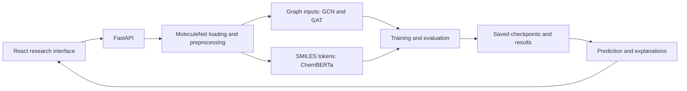

# Molecular Property Prediction with Explainable AI

A full-stack research application for comparing **graph neural networks and a molecular Transformer** on MoleculeNet tasks. A FastAPI backend handles datasets, training, inference and explanations; a React/TypeScript interface makes the workflow interactive.

## At a glance

| Area | Implementation |
| --- | --- |
| Graph models | GCN and GAT with PyTorch Geometric |
| Molecular text model | ChemBERTa using SMILES tokenization |
| Configured tasks | ESOL, FreeSolv, BBBP and ClinTox |
| Explanations | Attention visualization and Integrated Gradients |
| Backend | Python, FastAPI, RDKit, PyTorch, DeepChem |
| Frontend | React, TypeScript, Vite, Tailwind CSS |

The currently configured Transformer checkpoint is `seyonec/ChemBERTa-zinc-base-v1`; see [config.py](backend/app/config.py). Model identifiers and dataset choices should accompany any reported experiment.

## Architecture



Start with [models](backend/app/models), [dataset loading](backend/app/data/loader.py), [training](backend/app/training) and [explainability](backend/app/explainability).

## Run locally

Use Python **3.10+** (the source uses modern type annotations) and a Node.js version compatible with Vite 7; Node **22.12+** is a suitable baseline. A GPU is optional; CPU training is slower.

```bash
git clone https://github.com/shirahex/gnn-transformer-molecular-property-prediction-.git
cd gnn-transformer-molecular-property-prediction-
cd backend
python -m venv .venv
# macOS/Linux
source .venv/bin/activate
# Windows PowerShell: .venv\Scripts\Activate.ps1
python -m pip install -r requirements.txt
uvicorn app.main:app --reload --host 127.0.0.1 --port 8000
```

PyTorch/PyG compiled dependencies must match the local Python, PyTorch and CUDA versions. See the [PyTorch installation selector](https://pytorch.org/get-started/locally/) and [PyG installation guide](https://pytorch-geometric.readthedocs.io/en/latest/install/installation.html) if wheel installation fails.

In a second terminal, from the repository root:

```bash
cd frontend
npm ci
npm run dev
```

Frontend: http://localhost:3000 · API: http://localhost:8000 · Swagger: http://localhost:8000/docs

Use `npm run dev`, not `npm start`: this frontend is a Vite application. The API client/proxy and CORS configuration assume the ports above.

## First experiment

1. Start the backend and open the API docs.
2. Load a configured dataset through the dataset API.
3. Start a training job through the training page or `POST /train/{model}/{dataset}`.
4. Inspect progress, saved results and model checkpoints.
5. Run prediction or explanations using that trained model and dataset.

Dataset downloads and pretrained weights require internet access on first use. No pretrained experiment checkpoints are included in this repository.

## API map

| Route | Purpose |
| --- | --- |
| `GET /health` | Service/device status |
| `GET /datasets` | Supported datasets |
| `POST /train/{model}/{dataset}` | Start training |
| `GET /train/status/{job_id}` | Training progress |
| `GET /results` | Saved experiment comparisons |
| `POST /predict` | Single SMILES prediction |
| `POST /predict/batch` | Batch prediction |
| `GET /explain/{smiles}` | Explanation data |

Consult Swagger for the current request schemas and remaining routes.

## Results and interpretation

The committed [results file](outputs/results.json) currently contains an empty result list. It does not establish a reproducible benchmark. To report a comparison, save the dataset split, seed, preprocessing, checkpoint identifier, hyperparameters and held-out metrics together.

The inference code contains a fallback that returns zero-valued placeholders if a checkpoint is absent. **Those values are not model predictions.** Train a model and verify that its checkpoint loads before interpreting any output. Attention and attribution visualizations describe model behavior; they are not proof of chemical causation or clinical validity.

This is an academic prototype, not a validated drug-discovery or medical decision system.

## Configuration and repository map

Use `MOLECULAR_DEVICE`, `MOLECULAR_DATA_DIR`, `MOLECULAR_MODEL_DIR`, `MOLECULAR_OUTPUT_DIR` and `MOLECULAR_LR` for the environment settings implemented in [config.py](backend/app/config.py). Model-specific learning rates are defined separately in that file.

- `backend/app/`: API, models, data, training and explanations.
- `frontend/src/`: interactive research pages and API client.
- `data/` and `models/`: generated locally.
- `outputs/`: saved results.
- `run.sh`, `run.ps1`: convenience scripts; explicit commands above make the startup steps visible.

Existing Windows notes remain available in [WINDOWS_SETUP_GUIDE.md](WINDOWS_SETUP_GUIDE.md); the current commands above take precedence if older notes differ.

## License

No standalone software license file is currently included in the repository.
